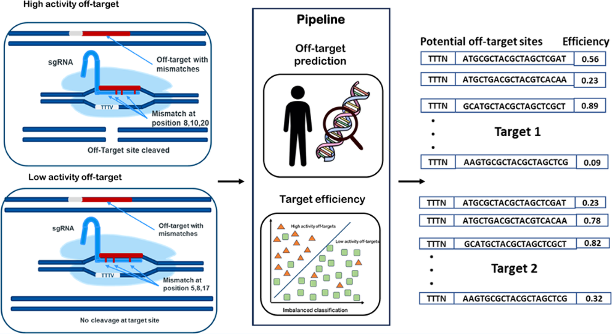

<div align="center">

# CRISPR/Cpf1 Off-Target Prediction

**Machine learning models and a genome wide pipeline for predicting off-target sites and target efficiency in the CRISPR/Cpf1 (Cas12a) system.**

[](https://pubs.acs.org/doi/10.1021/acsomega.3c05691)
[](https://doi.org/10.1021/acsomega.3c05691)
[](https://creativecommons.org/licenses/by-nc-nd/4.0/)
[](LICENSE)
[](https://www.python.org/)

</div>

---

<div align="center">



<sub>Graphical abstract from Kesarwani, Vora and Sundar, *ACS Omega* **2023**, 8, 45578−45588. Open access under CC-BY-NC-ND 4.0.</sub>

</div>

---

## What this is

Cpf1 (Cas12a) cuts DNA at sites matched by a guide RNA. It also cuts at **off-target** sites that are similar but not identical, and that is one of the main problems holding back clinical use.

This repository holds the code behind our *ACS Omega* paper. It does two things:

1. **Finds potential off-target sites** for a guide RNA across the human genome.
2. **Scores each site** for how efficiently Cpf1 is likely to cut there.

Models were built separately for the two commonly used orthologs, **AsCpf1** (*Acidaminococcus* sp.) and **LbCpf1** (*Lachnospiraceae bacterium*).

> **Paper**
> Kesarwani P., Vora D.S. and Sundar D. (2023).
> *Improved Machine Learning-Based Model for the Classification of Off-Targets in the CRISPR/Cpf1 System.*
> **ACS Omega** 8 (48), 45578−45588. [doi:10.1021/acsomega.3c05691](https://doi.org/10.1021/acsomega.3c05691)

---

## Key results

### Classification performance

A multilayer perceptron trained on the combined feature set performed best for both orthologs. Scores on the held out test split:

| Species | Feature set | Precision | Recall | F1 | MCC |
|---|---|---|---|---|---|
| **AsCpf1** | Sequence | 0.92 | 0.90 | 0.91 | 0.82 |
| | Binding energy | 0.95 | 0.89 | 0.92 | 0.84 |
| | **Combined** | **0.92** | **0.91** | **0.92** | **0.83** |
| **LbCpf1** | Sequence | 0.92 | 0.90 | 0.91 | 0.82 |
| | Binding energy | 0.94 | 0.90 | 0.92 | 0.83 |
| | **Combined** | **0.91** | **0.92** | **0.91** | **0.82** |

The test sets are heavily imbalanced, as real off-target data is. AsCpf1 had 134 positives against 14,605 negatives. LbCpf1 had 129 against 20,078. The best model recovered 83% of true off-targets while correctly classifying 100% of negatives, with average precision of 0.90 on both.

Five fold cross validation gave a mean AUC of 0.82 for AsCpf1 and 0.81 for LbCpf1. Against **CRISPR-DT**, **DeepCpf1** and **CINDEL** on the same test split, every model here scored higher on AUC.

### Pipeline against existing tools

Benchmarked on a single target sequence with 12 experimentally known off-targets:

| Tool | Sites predicted | Known off-targets recovered | Runtime |
|---|---|---|---|
| **This pipeline** | 13,399 | **8 / 12** | 15 min |
| CC-TOP | 468 | 5 / 12 | 2−5 min |
| Cas-OFFinder | 9,581 | 0 / 12 | 5 min |
| CHOPCHOP | 0 | 0 / 12 | 2 min |
| CRISPRscan | 0 | 0 / 12 | 2−3 min |

It is slower, and it recovers more of what is actually there.

### What the sequence features say

- **Thymine is strongly disfavoured** next to the PAM. Guanine is favoured in high activity off-targets.
- **Mismatches cluster in the trunk region**, at positions 16, 17 and 18 from the PAM.
- **Transition mismatches** are preferred at those same positions.
- A **low to moderate melting temperature** in the nonseed region and the **base dependent PAM binding energy** were the strongest predictors of high activity.
- GC content, some dinucleotide frequencies, bulge count and mismatches in the seed and trunk regions also separated the two classes.

---

## What is in this repository

### Analysis notebooks

| Notebook | Contents |
|---|---|
| `AsCpf1_allFeatureSets_AllAlgos.ipynb` | Training and comparison of all algorithms on all AsCpf1 feature sets |
| `LbCpf1_allFeatureSets_AllAlgos.ipynb` | The same for LbCpf1 |
| `Position-specificFeaturesAsCpf1.ipynb` | Position specific nucleotide preference and enrichment, AsCpf1 |
| `Position-specificFeaturesLbCpf1.ipynb` | The same for LbCpf1 |

Six algorithms were optimised on each feature set: LinearSVC, RandomForest, AdaBoost, MLPClassifier, LogisticRegression and DecisionTree.

### Prediction pipelines

Three pipelines under `OT_PredPipelines/`, one per feature set. Each ships a trained model for both orthologs.

| Folder | Features used | Models included |
|---|---|---|
| `SeqClassifier/` | Sequence only | `SeqClassifier_AsCpf1.pkl`, `SeqClassifier_LbCpf1.pkl` |
| `MMEClassifier/` | Mismatch and binding energy | `MMEClassifier_AsCpf1.pkl`, `MMEClassifier_LbCpf1.pkl` |
| `CombClassifier/` | Both combined, best performing | `CombClassifier_AsCpf1.pkl`, `CombClassifier_LbCpf1.pkl` |

Each folder contains:

- `Fasta36_SeqSearch.py` — searches the human genome for sites similar to the guide
- `*FeatureExtractor_*.py` — builds the feature table for those sites
- `AsCpf1_main.py` / `LbCpf1_main.py` — runs the search, extracts features, and scores each site

---

## How it works

```
guide RNA (FASTA)
        │
        ▼
┌───────────────────────┐
│  FASTA36 search       │   finds similar sites across the human genome
└───────────────────────┘
        │
        ▼
┌───────────────────────┐   one hot encoding, mismatch counts and types,
│  Feature extraction   │   bulges, GC content, dinucleotide frequency,
│                       │   melting temperature, MFE, PAM binding energy
└───────────────────────┘
        │
        ▼
┌───────────────────────┐
│  MLP classifier       │   trained per ortholog
└───────────────────────┘
        │
        ▼
 off-target sites + predicted efficiency (CSV)
```

FASTA36 was chosen over BLASTn and BOWTIE after testing all three. BLASTn was too stringent and missed highly divergent sites. BOWTIE did not allow gaps. FASTA36 recovered every experimentally known off-target along with other candidate locations.

| Species | FASTA36 | BLASTn | BOWTIE |
|---|---|---|---|
| LbCpf1 | 80,346 | 141 | 1,454,619 |
| AsCpf1 | 58,431 | 124 | 483,546 |

---

## Requirements

Linux. The pipeline calls FASTA36 as an external tool.

**Tools**

- [FASTA36](https://github.com/wrpearson/fasta36)
- [ViennaRNA package](https://www.tbi.univie.ac.at/RNA/)
- Human reference genome, GRCh37 (hg19)

**Python packages**

```bash
pip install pandas numpy scikit-learn joblib biopython ViennaRNA
```

---

## Usage

Run from inside the folder of the pipeline you want.

**Find potential off-target sites**

```bash
cd OT_PredPipelines/CombClassifier
python3 Fasta36_SeqSearch.py guide.fasta GRCh37.fna off_targets.csv
```

**Find sites and score their efficiency**

```bash
# AsCpf1
python3 AsCpf1_main.py guide.fasta GRCh37.fna results.csv

# LbCpf1
python3 LbCpf1_main.py guide.fasta GRCh37.fna results.csv
```

All three arguments are positional: the guide RNA in FASTA format, the reference genome, and the output file.

Swap `CombClassifier` for `SeqClassifier` or `MMEClassifier` to use a different feature set. `CombClassifier` is the best performing one and is the recommended default.

---

## Repository structure

```
├── AsCpf1_allFeatureSets_AllAlgos.ipynb     model training and comparison, AsCpf1
├── LbCpf1_allFeatureSets_AllAlgos.ipynb     model training and comparison, LbCpf1
├── Position-specificFeaturesAsCpf1.ipynb    feature importance, AsCpf1
├── Position-specificFeaturesLbCpf1.ipynb    feature importance, LbCpf1
├── OT_PredPipelines/
│   ├── SeqClassifier/                       sequence features
│   ├── MMEClassifier/                       mismatch and binding energy features
│   └── CombClassifier/                      combined features, best performing
├── docs/
│   └── graphical_abstract.png
├── LICENSE
└── README.md
```

---

## Citation

If you use this code or the models, please cite the paper:

```bibtex
@article{Kesarwani2023Cpf1,
  title   = {Improved Machine Learning-Based Model for the Classification
             of Off-Targets in the CRISPR/Cpf1 System},
  author  = {Kesarwani, Pragya and Vora, Dhvani Sandip and Sundar, Durai},
  journal = {ACS Omega},
  volume  = {8},
  number  = {48},
  pages   = {45578--45588},
  year    = {2023},
  doi     = {10.1021/acsomega.3c05691}
}
```

---

## Questions

Found a problem or have a suggestion? [Open an issue](https://github.com/PragyaKesar/CRISPR-Cpf1_study/issues/new).

## License

Code is released under the [MIT License](LICENSE).

The graphical abstract is reproduced from the open access article under [CC-BY-NC-ND 4.0](https://creativecommons.org/licenses/by-nc-nd/4.0/).

## Author

**Pragya Kesarwani** · [LinkedIn](https://www.linkedin.com/in/pragya-kesarwani-87242a3b/) · [GitHub](https://github.com/PragyaKesar)
